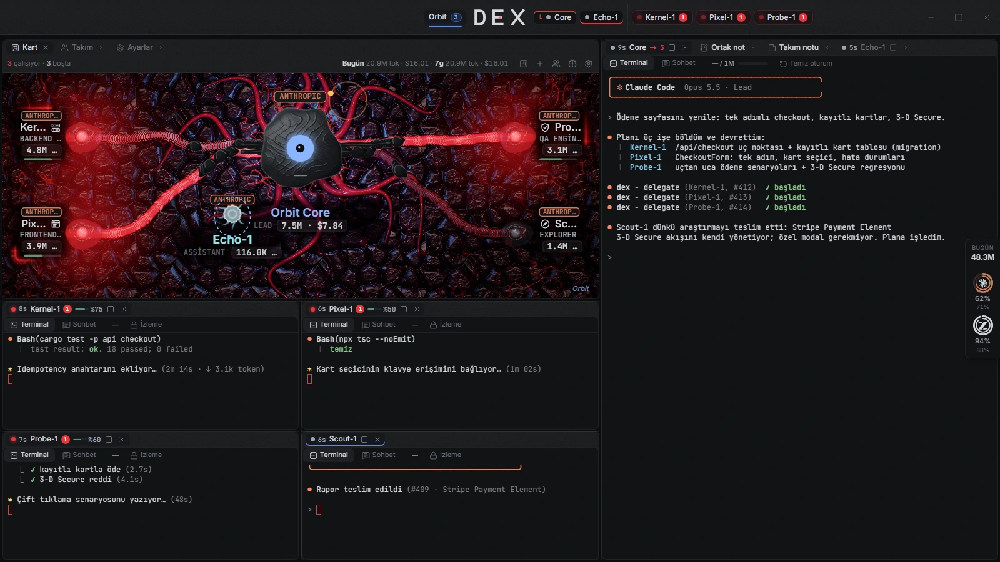
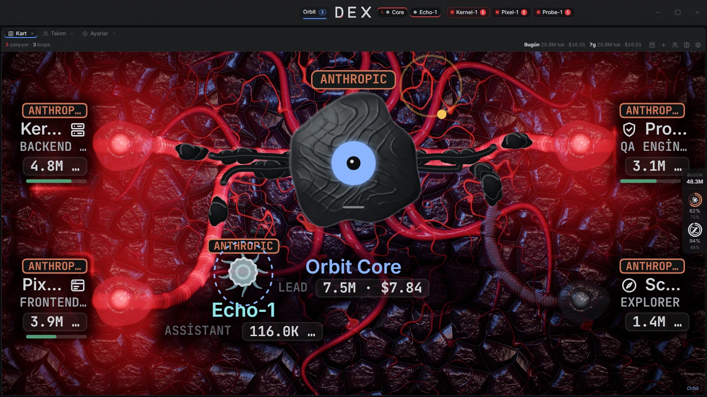
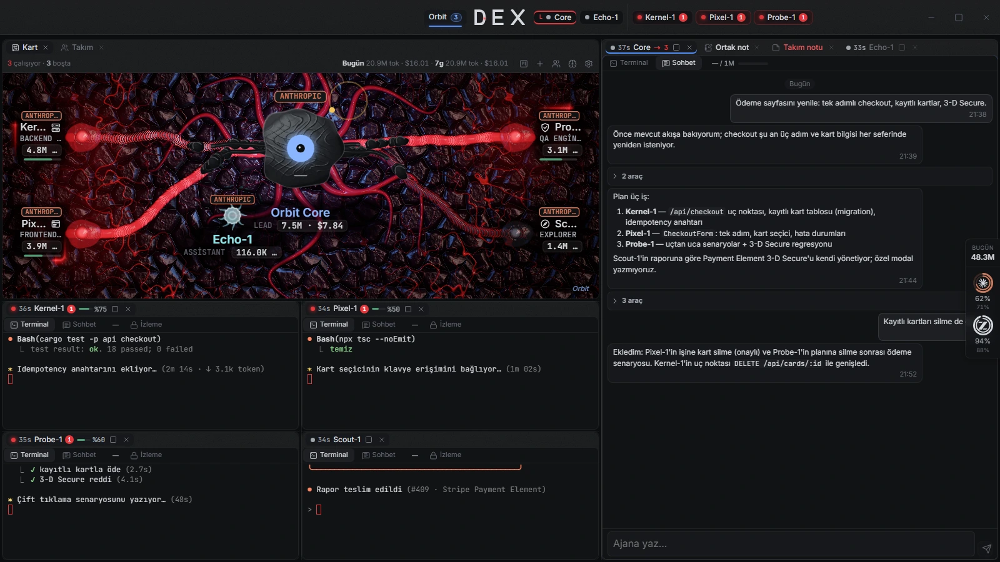
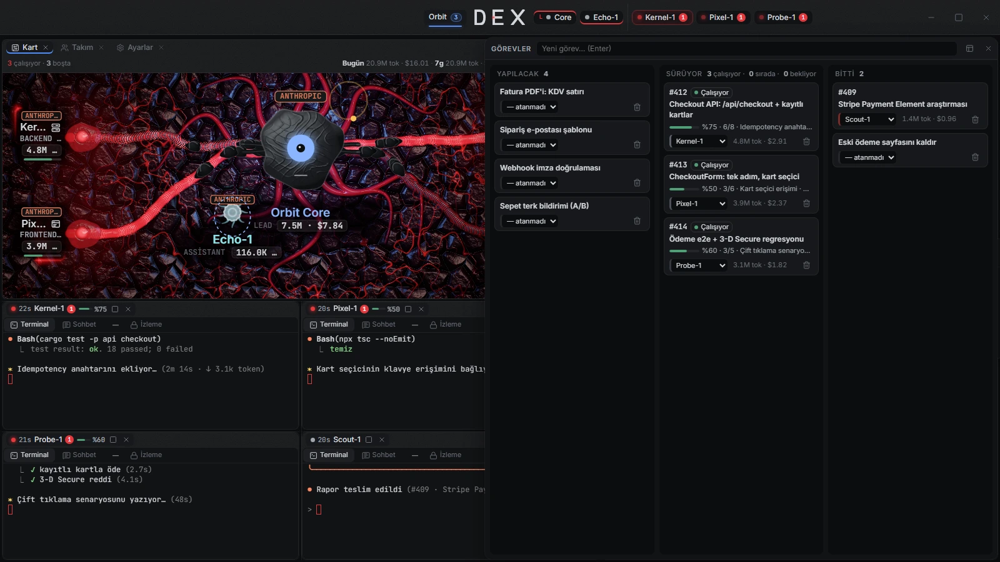
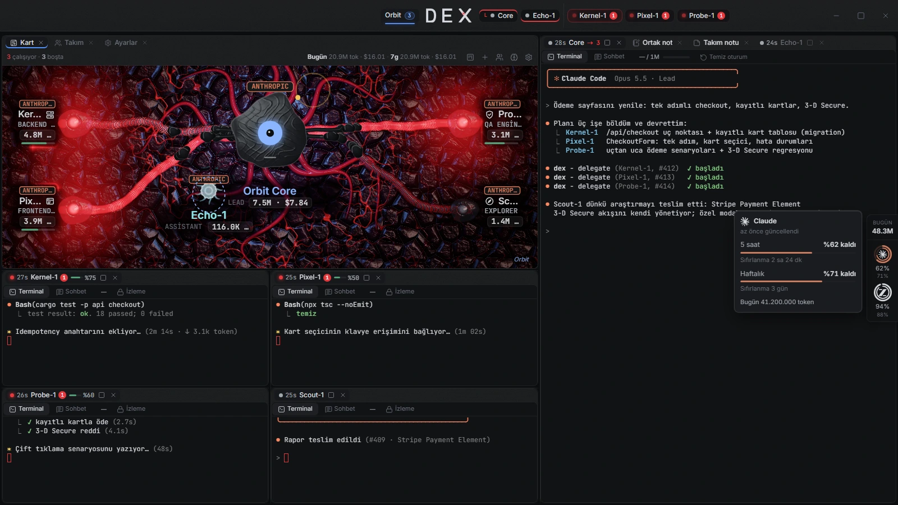
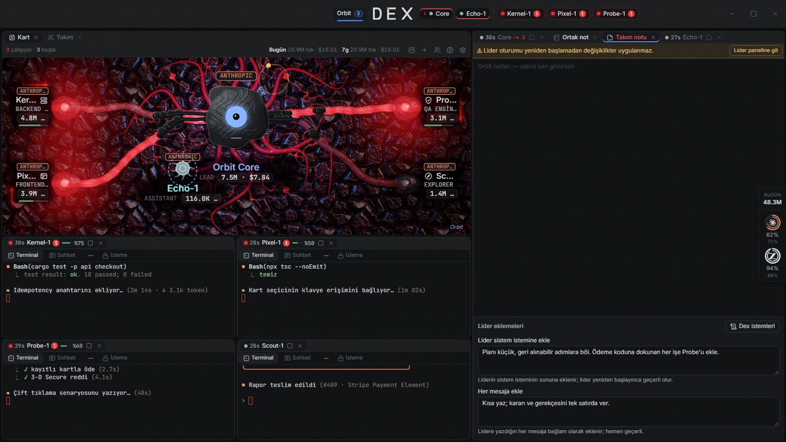
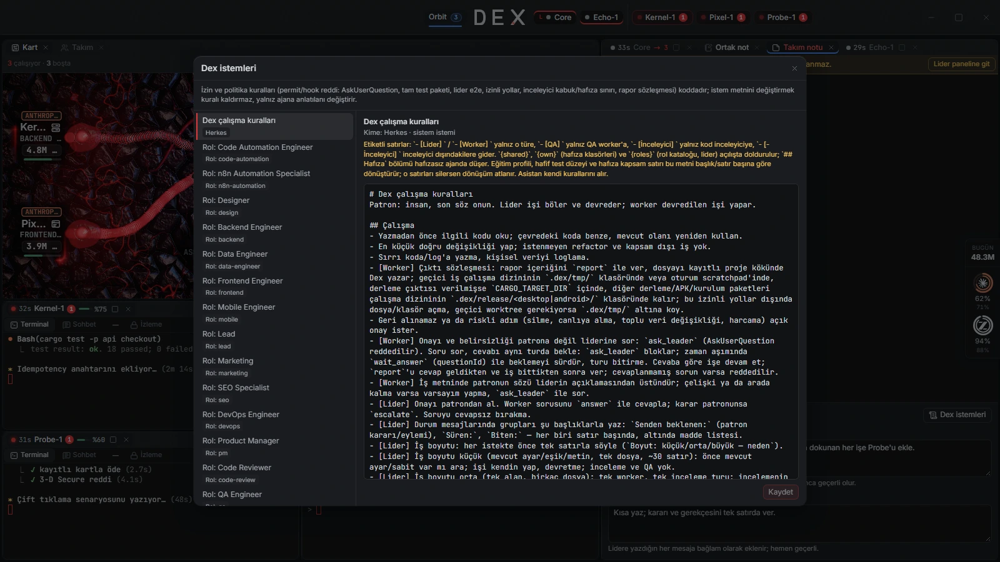
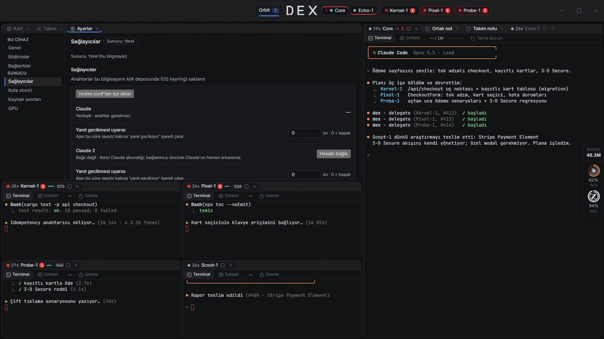
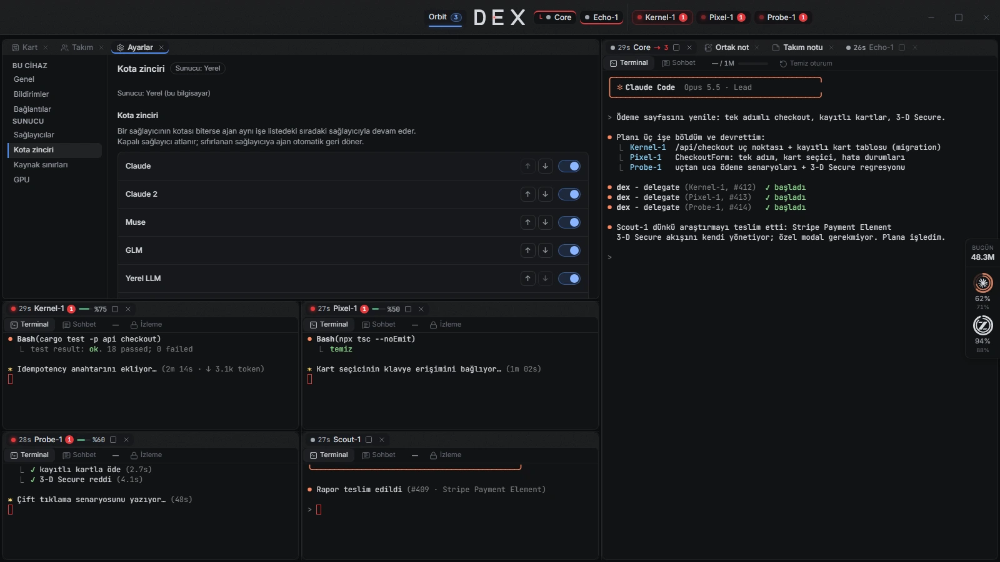

# Dex

Dex is a desktop multi-agent orchestrator for **Claude Code**. A leader delegates work to workers; you follow their terminals, task board, plans and results in one app. The UI and bundled agent instructions are currently **Turkish**.

Türkçe not: Dex, Claude Code ajanlarını lider ve worker takımlarıyla yönetir. Arayüz Türkçedir; birincil platform Windows'tur.



Screenshots show Dex 0.2.0 with made-up demo data ([how they are made](docs/screenshots/README.md)).

## What it does

- **Teams.** Leaders and workers, a task board, delegation and dependency plans ([delegation](crates/dex-core/src/delegate.rs), [plans](crates/dex-core/src/plan.rs)). Leaders size each request: small work they do themselves, medium work goes to one worker with one review round, large work starts with a decision note to the owner, then a plan ([rules](crates/dex-core/src/rules.rs), [lead role](docs/roles-v2/lead.md)).
- **Worktrees and review.** Each delegated job gets its own Git worktree under `.dex/wt/` on branch `dex/<agent>/<id>`; plan steps start with their prerequisites' branches merged in. When the team has a code-review member, merges pass a review gate: a reviewer other than the author answers `onay` (approve) or `düzelt` (fix), bound to the reviewed commit. Without that role, there is no review gate ([worktrees](crates/dex-core/src/worktree.rs), [review](crates/dex-core/src/review.rs)).
- **Merge checks.** A target branch that commits a `.gitleaks.toml` opts into fail-closed merges: the full incoming history is scanned with gitleaks, commit identities must be GitHub noreply addresses, and branches that touch policy files (permission policy, hooks, CI, scanner config) need the owner's approval ([merge gate](crates/dex-core/src/merge_gate.rs)).
- **Policies.** Hooks apply role and job policies to tool use. Worker permission requests are answered by policy: safe work inside the worker's folders is allowed, dangerous commands are denied, anything else goes to the leader as a numbered permit request; command chains are judged segment by segment. Running the full Playwright suite is reserved for the QA role ([hooks](crates/dex-core/src/hooks.rs), [policy](crates/dex-core/src/permit.rs), [test budget](crates/dex-core/src/test_budget.rs)).
- **MCP server.** Agents talk to Dex through a built-in MCP server: leaders delegate, plan, merge, answer worker questions and propose new members; workers report and ask their leader. Tool access is enforced per role and job ([MCP](crates/dex-core/src/mcp.rs)).
- **Memory.** Each agent gets a shared team memory and a private memory folder. Their index is injected at session start and agents search it with `memory_search` ([hooks](crates/dex-core/src/hooks.rs), [memory map](crates/dex-core/src/memory.rs)).
- **Prompts.** Prompts are layered: role text, the project's `.dex/stack.md` and Dex rules. Per team, the owner can append to the leader's system prompt and to every message. Editing text never lifts a code-enforced policy ([prompts](crates/dex-core/src/prompts.rs), [stack](crates/dex-core/src/stack.rs)).
- **Engine chain.** Claude → Claude 2 (a second subscription account) → Muse → GLM → local LLM. Only permanent quota or credit exhaustion triggers a switch, and the session continues with `--resume`; transient errors do not. Above 85% of the 5-hour Claude window, workers (not leaders) move ahead proactively. Agents are not moved back automatically ([chain](crates/dex-core/src/chain.rs), [quota](crates/dex-core/src/quota.rs)).
- **Core (dexd).** The desktop runs its core as a local `dexd --local` process; the same binary runs headless (`dexd serve`) on your own host. Devices pair with a one-time 10-minute code (`dexd pair`) and can be revoked (`dexd devices revoke`). Updates drain running jobs first and resume leaders afterwards ([dexd](crates/dexd/src/main.rs), [restart](crates/dex-core/src/restart.rs)).
- **Owner approvals.** New members, cancelling or reassigning a job that has not started, and GPU access take effect only after the owner approves ([proposals](crates/dex-core/src/proposals.rs), [job changes](crates/dex-core/src/job_change.rs)).
- **Other behavior.** Job progress is read from the worker's own CLI task list ([progress](crates/dex-core/src/progress.rs)); a turn with no reply gets a "slow reply" mark without stopping the agent ([first reply](crates/dex-core/src/first_reply.rs)); a leader writes a hand-over note before a fresh session ([leader reset](crates/dex-core/src/leader_reset.rs)); each job has an effort level ([effort](crates/dex-core/src/effort.rs)); a repository map is kept in `.dex/map.md` ([repo map](crates/dex-core/src/repomap.rs)); API-equivalent cost is estimated from transcripts ([cost](docs/usage-cost.md)).

## The app

**Workspace.** Each team's screen is one dock: leaders, workers, shells, the Kart, the board, notes, memory and processes are panels you can split, tab, float and drag. Moving a panel never restarts a terminal. A layout can be saved as a favourite and applied to other teams ([workspace](src/layout/Workspace.tsx)).

**Kart.** A live map of the team: the leader's Core in the middle, workers as symbiote bodies, the personal assistant (Echo) beside Core. Colour is the status language: red working (a laser circles the label), amber `?` waiting or question, amber `!` unread result, bright red `!` error, dim idle. Drops along a strand show questions (amber), finished (green) or failed (red) jobs. Core's balloon carries approval cards ([Kart](src/office/symbioteCard.ts)).



**Terminals and chat.** Every agent runs in a real terminal. A Chat tab shows the same session as a readable transcript with Markdown, collapsed tool runs, delegations and buttons for the CLI's prompts. Shell panes run your own PowerShell. Each pane's header shows the session's context fill; at the red threshold *Temiz oturum* (fresh session) is highlighted ([chat](src/chat/ChatView.tsx), [context meter](src/usage/ContextMeter.tsx)).



**Task board.** A drawer (`` ` ``) or dock panel with To do / In progress / Done columns and quick add. Cards show the job's live state and, while a worker runs, its progress from its own task list (`%43 · 3/7 · current step`) ([board](src/board/Board.tsx)).



**Usage strip.** Floats on the right, left or top edge. Each provider ring shows the 5-hour (outer) and weekly (inner) window; hovering opens the details. A configured GPU broker adds its owner, queue and today's images ([strip](src/usage/UsageStrip.tsx)).



**Notes and prompts.** *Ortak not* (all teams) and *Takım notu* are your own Markdown notes. The team note page also holds the leader's prompt appends (system prompt / every message) and a viewer that shows and overrides Dex's built-in prompt parts; policies stay in code ([team note](src/layout/TeamNotes.tsx), [prompt parts](src/layout/PromptParts.tsx)).

<p>
  
  
</p>

**Settings.** Split into *This device* (appearance, layout, screen capture, sounds, stall alerts, servers, Tailscale access) and *Server* (provider keys and models, quota chain order, resource limits, GPU). Server settings belong to the active team's host ([settings](src/settings/Settings.tsx)).

<p>
  
  
</p>

**Also in the app:**

- **Keyboard.** `Ctrl+K` (in a terminal `Ctrl+Shift+P`) opens the command palette: teams, agents, panels, settings, new task. `` ` `` toggles the board (``Ctrl+` `` in a terminal), `Ctrl+Tab` leaves a terminal, `Ctrl+wheel` / `Ctrl+0` zoom terminal text ([palette](src/palette/CommandPalette.tsx)).
- **Screen capture** (Windows). `Ctrl+Shift+S` (configurable) dims every monitor; the dragged region is saved under *Pictures\Screenshots* and its path is put on the clipboard ([capture](src-tauri/src/snip.rs)).
- **Processes** (Windows). Each agent's child processes with CPU/RAM and masked command lines; stop a runaway one ([processes](src/procs/Procs.tsx)).
- **Memory map.** A read-only graph of team and agent memory notes and their `[[links]]` ([memory map](src/memory/MemoryMap.tsx)).
- **Projects.** A team can hold several project folders; the top-bar picker chooses where new shells and the leader's next session work. Running agents are never switched ([picker](src/project/ProjectPicker.tsx)).
- **Decisions and alerts.** Member proposals, escalated questions and GPU requests come to you as cards. Stalled or slow-to-answer agents get an amber mark and a desktop notification. Short synthesized sounds mark turn ends, questions and finished jobs; each can be switched off ([stall](src/stall.ts), [sounds](src/sound/model.ts)).
- **Core band.** If the local core is down or older than the UI, a band offers to start it or restart it as this build ([band](src/team/CoreBanner.tsx)).

## Status and platforms

Early development, version 0.2.0 ([manifest](package.json)). CI checks builds and unit tests; it does not establish desktop feature parity or signed release readiness.

| Platform | Status | Scope |
| --- | --- | --- |
| Windows | Primary | Desktop; CI build and unit-test jobs |
| macOS | Experimental | CI build and unit-test job; no process panel or screen capture |
| Linux | Experimental | Not in the current CI; no process panel or screen capture |
| Android | Experimental, optional | Remote client; requires a paired dexd host and separate build/signing setup |

Sources: [CI](.github/workflows/ci.yml), [process panel](crates/dex-core/src/proc.rs), [capture](src-tauri/src/snip.rs), [mobile client](src/mobile/MobileApp.tsx).

## Windows quick start

Install these before building:

| Requirement | Version / setup |
| --- | --- |
| Git | Available on PATH; Git for Windows/Git Bash for Claude Code's Bash tool ([CLI setup](https://code.claude.com/docs/en/setup)) |
| Node.js | **24.14.1**, pinned in [.nvmrc](.nvmrc) |
| pnpm | **10.17.0**, pinned in [package.json](package.json) |
| Rust via rustup | **1.96.0**, pinned in [rust-toolchain.toml](rust-toolchain.toml); use the Windows MSVC toolchain |
| Native build tools | Microsoft C++ Build Tools, **Desktop development with C++**, Windows SDK and WebView2 Runtime; follow [Tauri 2 prerequisites](https://v2.tauri.app/start/prerequisites/) |
| Claude Code | Install separately and complete login before launching agents |
| curl | **8.3+** on the hook process PATH, for curl's environment expansion |

CLI/hook requirements: [Claude launch](crates/dex-core/src/pty.rs), [curl hooks](crates/dex-core/src/hooks.rs). Neither the CLI nor its subscription is included with Dex.

From a checkout of this repository:

```powershell
pnpm install
pnpm tauri dev
```

The dev command builds local `dexd` before starting the desktop UI ([Tauri config](src-tauri/tauri.conf.json)). No remote server is needed. In the Turkish UI, configure your project/team and start its leader; Claude Code login is separate.

For a distributable desktop package:

```powershell
pnpm release
```

**Use `pnpm release`: plain `pnpm tauri build` does not prepare or include the required dexd sidecar.** The release script builds it and applies the [sidecar config](src-tauri/tauri.release.conf.json) ([script](scripts/dexd-sidecar.mjs), [package scripts](package.json)).

## Optional modules

| Module | Setup and behavior without it |
| --- | --- |
| Remote dexd / tailnet | Pair your own host; remote hosts start empty and tailnet is disabled by default. Local desktop work continues without either. Tailnet needs Tailscale. See [self-hosting](docs/deploy.md), [host registry](src/api/hosts.ts), [tailnet](crates/dexd/src/tailnet.rs). |
| GPU broker | Configure broker addresses and credentials. Without them, GPU operations are unavailable; normal local agent work continues. Leaders request access and only the owner grants it; submissions need an approved job grant and budget. Broker address and token never reach agents ([GPU](crates/dex-core/src/gpu.rs)). |
| Usage strip | dexd measures Claude, Claude 2, GLM and Muse 5-hour and weekly quota windows and today's agent tokens. A provider without credentials or a readable quota shows "--"; agents run regardless ([usage](crates/dex-core/src/usage.rs)). |
| Browser tools | Browser-enabled roles use Node/npx and Playwright MCP 0.0.79. Windows uses Edge, macOS Chrome, Linux Playwright Chromium. Missing browser/package access breaks those tools; other roles do not require them ([browser](crates/dex-core/src/browser.rs)). |
| Android | Requires a paired host. The phone app shows Kart, agents, board and notes; each agent opens as chat or a terminal with an extra-keys bar. `pnpm release:apk` is a separate SSH/SDK/NDK/keystore pipeline; configure it before use. `pnpm release:all` also runs that pipeline ([APK script](scripts/release-apk.mjs), [mobile client](src/mobile/MobileApp.tsx)). |
| Phone share / assistant | Share text or an image from Android to the team's assistant (Echo). Content stays on the host and never reaches the task board. Replies are stored; with your own Firebase service account a content-free push announces them ([inbox](crates/dex-core/src/inbox.rs), [push](crates/dex-core/src/push.rs)). |

## Data and network

Desktop data and config use Tauri's OS application directories for the bundle identifier. On Windows these are under `%APPDATA%`; Core stores `dex.db` and `logs/` there. Project memory/worktrees/results also use the project's `.dex/` tree; team and agent memory depend on the selected project/team scope. Credentials use the OS secret store ([Tauri directories](https://v2.tauri.app/reference/javascript/api/namespacepath/), [desktop paths](src-tauri/src/core_proc.rs), [Core paths](crates/dex-core/src/paths.rs), [project scope](crates/dex-core/src/project_context.rs), [secrets](crates/dex-core/src/secrets.rs)).

Dex has no analytics or telemetry collector. It does make authenticated model catalogue and quota requests; optional services and agent actions make additional connections. See [network behavior](docs/network.md) before use.

## Security

**Agents run with broad access by default.** Claude uses `bypassPermissions`. Agents can act with your OS user's file, command and network privileges ([Claude launch](crates/dex-core/src/pty.rs)).

Dex's hooks apply role/job policies and the Core controls delegation, GPU grants and applicable merge reviews and checks. This is application policy, **not an OS sandbox or complete containment boundary**. Worktrees isolate Git work, not the host. Use an isolated account or machine for untrusted repositories and tasks. Report vulnerabilities through [SECURITY.md](SECURITY.md).

## Contributing and support

For contributors, install the repository Git hook:

```powershell
npm run hooks:install
```

Run it before your first contribution. It downloads and verifies gitleaks **8.30.0** and installs the pre-commit and commit-msg hooks; a missing or invalid gitleaks binary blocks commits. `pnpm install` does not install these hooks. CI also scans the tree and history ([installer](scripts/install-hooks.mjs), [hook](scripts/hooks/pre-commit), [CI](.github/workflows/ci.yml)). These Git hooks are separate from runtime agent hooks.

The README screenshots are regenerated with `pnpm screenshots` ([details](docs/screenshots/README.md)).

Open an issue for reproducible bugs or focused feature requests. Include Dex/CLI versions, OS, reproduction steps and redacted errors. Remove credentials, prompts, personal paths and host details. Use private reporting for security issues. Support is best effort; Dex is provided **as is, without warranty**.

Dex code is [MIT licensed](LICENSE), Copyright (c) 2026 hakunokina. See [NOTICE](NOTICE) for third-party material, generated office artwork and trademarks.
